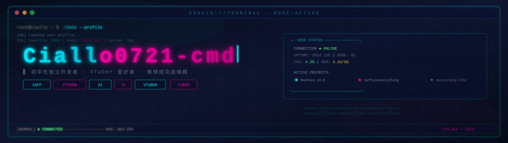

# Ciallo～(∠・ω・)⌒★

<p align="center">
  
</p>

<p align="center">
  <a href="https://github.com/ciallo0721-cmd"></a>
  <a href="https://ciallo0721-cmd.top"></a>
  <a href="https://space.bilibili.com/478967440"></a>
  <a href="https://github.com/ayase-yukio-org"></a>
</p>

---

```
// ============================================================
//  绫濑雪绪 (Ayase Yukio)
//  ------------------------------------------------------------
//  A student developer who loves AI, ACGN, and making stuff.
//  INFP - VTuber fan - Cyberpunk enthusiast
// ============================================================
```

```
// == Profile ==
//
// 在现实和二次元之间反复横跳的脆皮
// 喜欢折腾代码，把想做的稀奇古怪东西都塞进项目里

const me = {
  name:     "绫濑雪绪",
  alias:    "Ayase Yukio",
  username: "ciallo0721-cmd",
  type:     "INFP-T",
  role:     "student - indie_dev",
  vibe:     "VTuber x AI x Cyberpunk",
  focus:    ["AI / CV", "Web", "桌面小工具"],
  org:      "ayase-yukio-org  --  大项目长期维护的地方",
  motto:    "做没人做、但有人需要的小东西 -- 能跑就行，能跑得好更好",
};
```

---

```
// == CONTACT ==

const contact = {
  // 主要
  qq:       "3627742771",
  email:    ["ciallo0721cmd@gmail.com", "nb666mc26@outlook.com"],
  github:   "https://github.com/ciallo0721-cmd",
  org:      "https://github.com/ayase-yukio-org",
  bilibili: "https://space.bilibili.com/478967440",
  website:  "https://ciallo0721-cmd.top",

  // 社交
  twitter:   "https://x.com/ciallo0721cmd",
  youtube:   "https://youtube.com/@ciallo0721-cmd",
  tiktok:    "https://www.tiktok.com/@ciallo0721cmd",
  litlink:   "https://lit.link/zh-tw/ciallo0721cmd",
  discord:   "https://discord.gg/fx4N3jg6",
  steam:     "https://steamcommunity.com/profiles/76561199473709076",
  facebook:  "https://facebook.com/profile.php?id=61590168321280",
  instagram: "https://instagram.com/moyu0721cmd",
  ifdian:    "https://ifdian.net/a/ciallo0721-cmd",
};
```

---

<p align="center">
  <b>Ciallo～(∠・ω・)⌒☆</b><br>
  关注永雏塔菲谢谢喵！
</p>

---
<details>
<summary>喵喵喵</summary>
  ```
  Welcome to our gitting
  Are you into committing?
  No need for being coy!
  We'll improve your update
  Have a friggin' cloning
  And must you bring a bug?
  ```
  ```
  Time to write some code now, don't be scared to show how
  The deadline's days away
  You could help with debugging
  Or with README hugging
  And I'll push alone today
  ```
  ```
  Maybe we're friends, maybe we're more
  How could they star a simple dev next door?
  I'm just not the type they're looking for
  ```
  ```
  Hey, Ciallo, you doing okay?
  I'm having a difficult day
  ...I'd say! Your repo seems lonely!
  I wish I could make it grin
  All it wants is a commit back again
  It's depressed and stressed and feeling blue
  So I don't want bugs hanging around you
  ```
  ```
  Just git, just git
  Just git, just git
  Just git, just git
  Just git, just, just git
  ```
  ```
  AI is my passion, don't you dare be bashin'
  The model's got finesse
  Maybe you should borrow my GPU until tomorrow
  Were you looking up my repo?
  Let's go train a model
  What about the issue?
  Let's talk about my code instead
  I've been learning CV, and I build web at night
  And I can't get this bug out of my head
  ```
  ```
  Can't look away, can't help but blush
  Where did I get this overwhelming rush?
  It's sharp as a knife and twice the crush
  Yo, there's something I think you should know
  I've never seen my repo so—
  —Clean and chill, and still kinda sweaty
  And I don't mind cutting to the chase:
  I'm in love with code and your gorgeous face
  That's a sentiment I can't allow
  So my dear friend bug is getting the point now
  ```
省略一堆justgit
  ```
  Could you have guessed? Maybe you knew?
  bug is next, I'm refactoring her too
  We don't need cupcakes or poems or tea
  I only need you to star my repo
  Hey
  There's no one else in our way
  So look at me and just say, right here, my dear
  That you love code
  And we'll sit here 'till the end of time
  'Cause I've earned this and you're finally mine
  And I'm sorry what you've had to see
  But it no longer matters, 'cause now you belong to me
  ```
  ```
  Just debugging(Forever) just debugging(forever)
  Just debugging(Forever) just debugging(forever)
  Just debugging(Forever) just debugging(forever)
  ```
  ```
  Just debugging,just debugging
  Just debugging,just debugging
  Just debugging,just debugging
  ```
(取自justmonika)

</details>
